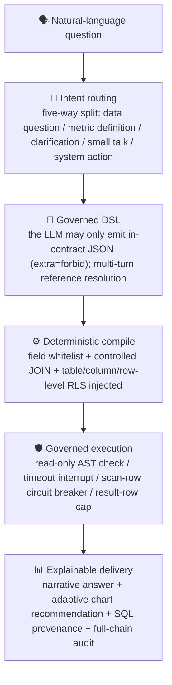
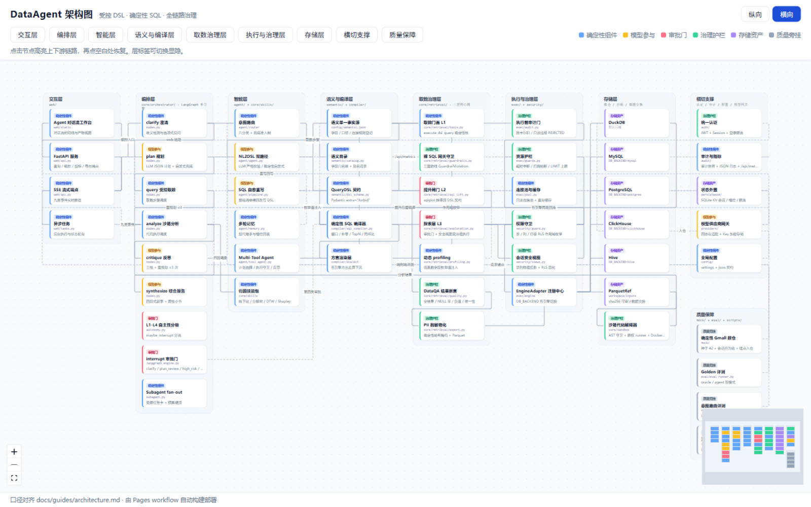

<div align="center">
  

  # DataAgent

  <sub><a href="README.md">中文</a> · <b>English</b></sub>

  **An enterprise-grade Data Agent: natural language → governed DSL → deterministic SQL → DuckDB** (switchable to MySQL / PostgreSQL / ClickHouse / Hive)

  The LLM only emits contract-bound JSON — it never writes raw SQL. Zero hallucinated queries, zero injection, zero arbitrary joins.

  <p>
    
    
    
    
    
    
    
  </p>

  **In one sentence**: put the model in a contract-shaped cage — the model only *understands the question*; the data always comes out of deterministic code.

</div>

---

## 🧠 Core pipeline (one diagram)



## 🗺️ Interactive architecture diagram

GitHub READMEs do not run scripts, so the interactive canvas is deployed on GitHub Pages (`architecture-ui`, built and deployed automatically by CI). It supports layer visibility toggles, upstream/downstream highlighting and vertical/horizontal layouts.

[](https://cwentor.github.io/DataAgent/)

👉 [Open the interactive architecture diagram](https://cwentor.github.io/DataAgent/)

## ✨ Features

- **Governed DSL contract**: Pydantic V2 with `extra="forbid"`; fields, operators and aggregations are closed enums — the LLM never emits raw SQL
- **Deterministic compilation**: SQL is produced only by the compiler — aggregation / ratio / time / window / gap-filling / Top-N / period-over-period
- **Five backends, one contract**: `DB_BACKEND` switches DuckDB / MySQL / PostgreSQL / ClickHouse / Hive; the guardrail framework is engine-agnostic; golden evaluation stays anchored on the DuckDB dialect
- **Defense in depth**: unified auth + pre-generation scope narrowing + table/column/row-level RLS + pre-execution audit gate (cartesian / read-only violations REJECTED) + timeout / scan / result-row guardrails
- **Graph orchestration**: a single LangGraph engine with six nodes (clarify, plan, governed retrieval, sandbox analysis, reflection/replan, synthesis), four interrupt approval gates, L1-L4 autonomy levels and bounded self-healing
- **Sandbox & attribution**: AST guard + privilege-limited runner + Docker isolation; entropy drill-down / decomposition trees / DTW / Shapley skill pack
- **Honest fallback**: intent routing with admission-based fallback — no fabrication, assumptions made explicit (`assumptions` contract field), refusal as the last resort
- **Explainable & observable**: narrative answer + adaptive charts + SQL provenance + full-chain audit, structured logs and metrics

> The full feature list, organized by phase with each phase's key decisions, lives in [Feature overview](docs/guides/features.md) (Chinese).

## 🚀 Quick start

```bash
conda activate dataagent
pip install -r requirements-dev.txt
python -m mock.init_duckdb
python -m web.server 8000
```

> 🌐 Open <http://127.0.0.1:8000> in a browser. Full install, evaluation and offline self-check steps live in **[Quick start](docs/guides/quickstart.md)**.

---

## 📦 Deployment and usage guide

### 1. Prerequisites

| Dependency | Version |
|---|---|
| Python | `>=3.11`, pinned to `3.12` |
| Environment manager | Miniconda / Anaconda (`conda 26.x+`) |
| Package manager | pip |

> **Why these choices**: the domain kernel stays framework-free (the four entries in `requirements.txt` are unchanged); the orchestration/interaction layers have adopted mature frameworks since phase 17, pinned exactly (LangGraph for graph orchestration + FastAPI/uvicorn for the service layer — see `requirements-dev.txt`). Upgrades in 0.x ecosystems always go through a dedicated PR plus the full regression gate.

### 2. Clone and install

```bash
# Clone the repository
git clone <repository-url>
cd DataAgent

# Create and activate the conda environment
conda create -n dataagent python=3.12 -y
conda activate dataagent

# Install dependencies
pip install -r requirements-dev.txt
```

### 3. Initialize the warehouse

```bash
# Idempotent initialization of the local DuckDB warehouse (default backend)
python -m mock.init_duckdb
```

**Optional execution backends (`DB_BACKEND`)**: the default is `duckdb`; `mysql` / `postgres` / `clickhouse` / `hive` are also supported. All of them reuse the DuckDB DDL, transpiled at runtime, with row-identical source data, and each has its own service-level CI gate (full golden-DSL cross-backend parity + Review Focus cases).

| Backend | Initialize | Parity regression | CI image |
|---|---|---|---|
| MySQL | `python -m mock.init_mysql` | `tests/test_dual_backend_parity.py` | `mysql:8.0` |
| PostgreSQL | `python -m mock.init_postgres` | `tests/test_pg_backend_parity.py` | `postgres:16` |
| ClickHouse | `python -m mock.init_clickhouse` | `tests/test_clickhouse_backend_parity.py` | `clickhouse-server:24.8` |
| Hive | `python -m mock.init_hive` | `tests/test_hive_backend_parity.py` | `apache/hive:4.0.0` |

MySQL example (for the others, swap the `MYSQL_*` prefix for `POSTGRES_*` / `CLICKHOUSE_*` / `HIVE_*`):

```bash
# 1. .env (the build account needs CREATE/INSERT; runtime queries use a read-only account)
DB_BACKEND=mysql
MYSQL_HOST=127.0.0.1
MYSQL_PORT=3306
MYSQL_USER=<writable-account>
MYSQL_PASSWORD=<password>
MYSQL_DATABASE=gmall            # the database must already exist

# 2. Idempotent initialization (DDL transpiled at runtime; data row-identical to DuckDB)
python -m mock.init_mysql

# 3. Least privilege for the query account (deployment requirement)
# GRANT SELECT ON gmall.* TO dataagent_ro@'%';

# 4. Connectivity smoke test (golden evaluation is anchored to the DuckDB dialect)
python -m eval.eval_runner --backend mysql
```

Cross-backend parity regression (needs a local test database; skipped automatically when unconfigured):

```bash
MYSQL_TEST_HOST=127.0.0.1 MYSQL_TEST_USER=root MYSQL_TEST_PASSWORD=... \
python -m pytest tests/test_dual_backend_parity.py -q
```

**Version-following (important)**: the governance pipeline depends on engine behavior (EXPLAIN ANALYZE output format,
`max_execution_time`, default `sql_mode`), so upgrading any backend requires the full test suite plus the
cross-backend parity regression before release — that is the unavoidable cost of multi-engine support (see
`docs/designs/2026-10-25-mysql-support-design.md` §8.1).

### 4. Configure the LLM

```bash
# Create the config file from the template
copy .env.example .env
```

Edit `.env` and set at least the following:

```ini
# LLM access (required)
LLM_API_KEY=your-key-here
LLM_BASE_URL=https://api.openai.com/v1   # or DeepSeek / Kimi / Ollama
LLM_MODEL=gpt-4o-mini

# Execution-layer resource governance
QUERY_TIMEOUT_MS=30000         # statement timeout (ms)
MAX_SCAN_ROWS=10000000         # scan-row circuit breaker
MAX_RESULT_ROWS=20000          # hard cap on returned rows
SQL_SELF_HEAL_MAX_RETRIES=3    # SQL self-healing retries (default 3)

# Auth (mandatory in production)
AUTH_ENABLED=1
AUTH_JWT_SECRET=<strong-random-secret>    # python -c "import secrets;print(secrets.token_hex(32))"
AUTH_STRICT=1                  # strict production security mode
```

> **Offline development**: no real API key needed — run the local mock service:
> ```bash
> python tools/mock_llm_server.py 8765
> set LLM_API_KEY=sk-mock
> set LLM_BASE_URL=http://127.0.0.1:8765/v1
> set LLM_MODEL=mock
> ```

> **Multi-provider management**: besides the single provider in `.env`, the workspace "Settings" page lets you
> configure several model providers visually (OpenAI Chat / Responses and Anthropic protocols supported, keys encrypted
> at rest), and orchestration requests support per-request model switching. See [Configuration](docs/guides/configuration.md)
> and the [API reference](docs/guides/api.md).

### 5. Start the service

```bash
# Start the web UI (default port 8000)
python -m web.server 8000
```

Then open `http://127.0.0.1:8000`.

**Built-in demo accounts**:

| Account | Password | Scope |
|---|---|---|
| `admin` | `admin123` | All tables |
| `analyst` | `analyst123` | All tables, row-level access to 5 provinces only |
| `bob` | `bob123` | Restricted: no refund table / sensitive columns, Guangdong only |

### 6. Verify the deployment

```bash
# Run the whole unit-test suite
python -m pytest -q

# Golden evaluation (oracle mode)
python -m eval.eval_runner

# Golden evaluation (agent mode)
python -m eval.eval_runner --pipeline agent

# Intent-routing evaluation (guards against off-target answers)
python -m eval.intent_eval

# Print compiled SQL for inspection
python -m eval.eval_runner --print-sql
```

### 7. Code quality checks

Make sure these are all green before committing (the CI lint job runs each of them):

```bash
black --check .
ruff check .
python scripts/check_docs_links.py   # relative links and docs references
python -m pytest -q
```

Fix formatting and lint issues:

```bash
black .
ruff check --fix .
```

### 8. Continuous integration gates

`.github/workflows/ci.yml` runs on pull requests, pushes to master, and a nightly schedule:

| Job | Contents |
|---|---|
| `lint` | black + ruff + docs link check |
| `test` | rebuild the DuckDB warehouse → full pytest → golden evaluation (both modes) → intent routing evaluation |
| `mysql-parity` / `postgres-parity` / `clickhouse-parity` / `hive-parity` | start a real service container → build the warehouse → full golden-DSL cross-backend parity + Review Focus cases → catalog build smoke |
| `nightly` | schedule only: full test suite + three evaluations + boundary evaluation + RLS adversarial matrix |

> The four parity jobs are **service-level** verification: locally those cases are skipped when the engine is absent, so a green PR is the only proof that the backend path was actually executed.

### 9. API examples

**Log in and get a token**:

```bash
curl -X POST http://127.0.0.1:8000/api/auth/login \
  -H "Content-Type: application/json" \
  -d '{"username":"analyst","password":"analyst123"}'
```

**SSE streaming Data Agent session** (each frame is `data: <AgentStreamEvent JSON>`):

```bash
curl -N "http://127.0.0.1:8000/api/v1/agent/chat/stream?query=GMV%20of%20successful%20orders%20in%20May%202024" \
  -H "Authorization: Bearer <token>"
# data: {"turn_id":"t-ab12cd34","timestamp":1725868800000,"event":"plan_created",
#        "payload":{"plan":[{"id":"s1","title":"...","kind":"query","status":"pending"}]}}
# data: {..., "event":"tool_start", "payload":{"tool":{"name":"futurebi_dsl_query","input":{...}}}}
# data: {..., "event":"done", "payload":{"report":"## Analysis report..."}}
```

**Run a query**:

```bash
curl -X POST http://127.0.0.1:8000/api/query \
  -H "Content-Type: application/json" \
  -H "Authorization: Bearer <token>" \
  -d '{"query":"GMV distribution by category for successful orders"}'
```

The response contains the DSL, the SQL, column metadata, row count, a narrative explanation and visualization suggestions.

### 10. Production deployment notes

1. **JWT secret**: replace it with a strong random value (`secrets.token_hex(32)`)
2. **Strict mode**: with `AUTH_STRICT=1`, a weak secret or disabled auth makes startup fail
3. **Bind address**: use `WEB_HOST=0.0.0.0` in production; any non-localhost bind enters strict mode automatically
4. **Session sharing**: with multiple workers, set `AUTH_SESSION_DB` to persist sessions in SQLite
5. **Audit switch**: keep `AUDIT_ENABLED=1` in production

---

## 📦 Project structure

```text
DataAgent/
├── semantic/     # Semantic layer: governed DSL contract + data-driven field catalog (reads config/semantic.json at import)
├── agent/        # NL -> DSL: LLM / heuristic dual path, intent routing, RAG, multi-turn memory, replanning and reflection
├── core/         # Data Agent upgrade layer: retrieval facade (typed Tool + PII masking + raw-SQL gateway +
│                 # dynamic profiling + DataQA assertions + SQL lifting gate + exploration executor), orchestrator (LangGraph six nodes +
│                 # replanning error context), sandbox (AST guard + privilege-limited runner + Docker/subprocess backends),
│                 # skills (entropy drill-down / decomposition trees / DTW / Holt-Winters / Shapley)
├── providers/    # Multi-provider gateway: four protocol adapters / encrypted API keys / connectivity probes
├── compiler/     # DSL -> deterministic SQL; dialect/ holds five renderers (duckdb / mysql / postgres / clickhouse / hive)
├── exec/         # SQL execution: read-only AST check / pre-execution audit (cartesian breaker) / timeout / breakers / pool / self-healing;
│                 # engine/ is the engine abstraction: EngineAdapter protocol + five adapters + type mapping + plan parsing + watchdog
├── tools/        # Multi-tool orchestration: query / trend / export / metric explanation
├── present/      # Explanation + adaptive chart recommendation
├── security/     # Permissions: table/column/row-level RLS (config-driven) + secure view layer
├── auth/         # Authentication: JWT + Session + login rate limiting
├── audit/        # Audit snapshots + observability metrics + structured logs
├── web/          # Web UI / HTTP service / async queries / orchestration endpoints
├── eval/         # Golden evaluation (31 Gmall cases, oracle / agent dual mode) + intent routing evaluation (12 cases)
│                 #   + boundary evaluation + per-backend connectivity smoke (--backend mysql|postgres|clickhouse|hive)
├── mock/         # Deterministic DuckDB warehouse (Gmall e-commerce model: seed extraction / session chains / event JSON logs / parsing)
│                 #   + per-backend build entries (init_mysql / init_postgres / init_clickhouse / init_hive, DDL transpiled at runtime)
├── tests/        # 81 test files mirroring the source packages across 16 subdirectories (agent / audit / auth / compiler / core /
│                 #   engine / eval / exec / mock / persistence / present / providers / security / semantic /
│                 #   tools / web); cross-layer regressions and four-backend parity live at the root
├── scripts/      # Scripts: one-off verification entrypoints (P0-1 e2e / pen-test / Top10 review) + the docs link checker
├── .github/      # CI workflows (lint / test / four parity gates / nightly) and container configs (clickhouse users.d, hive-site)
└── docs/         # Project docs (guides / designs / plans / tasks / reviews — rules and phase index in docs/README.md)
```

## 🧩 Key technical choices

The selection philosophy that runs through the project: **zero framework dependencies at production runtime** (the core needs only pydantic / duckdb / python-dotenv / sqlglot), **determinism first** (security verdicts and quality checks are made by unit-testable deterministic code, not by an LLM), and **restrained in-house builds** (decide by the size of the need, align interface semantics with mainstream frameworks, keep a migration path).

| Area | Choice | Rationale |
| --- | --- | --- |
| Runtime & dependencies | Python 3.11+ (pinned to 3.12) + Miniconda; **4 core dependencies** (pydantic / duckdb / python-dotenv / sqlglot), plus one driver per optional backend (pymysql / psycopg / clickhouse-connect / pyhive+thrift) | The dependency surface is both the attack surface and the upgrade cost: the default DuckDB path pulls in no database driver, and a driver only participates when its backend is enabled. numpy / pandas / pyarrow are dev-only (numerics for the sandbox and skill packs) and never sit on the production retrieval path |
| Semantic layer `semantic/` | Pydantic V2 strong contracts (`extra="forbid"`) + `catalog.py` field whitelist as SSOT | The contract *is* the constraint: the LLM can only emit registered fields / operators / aggregations, and undeclared fields are rejected before compilation |
| Intelligence `agent/` | LLM / heuristic dual path + intent routing + multi-turn slot filling; RAG via character bigrams + TF-IDF cosine | Deterministic fallback without a key, safe degradation on LLM failure; retrieval needs no tokenizer, no vector store, no external model — identical, reproducible results on any machine |
| Orchestration `core/orchestrator/` | Single LangGraph engine (converged in phase 17 M4): six-node semantic port + generalized interrupts (clarify / plan_review gates) + L1-L4 autonomy levels + subagent fan-out; checkpointer support (ORCHESTRATOR_CHECKPOINT_DB, persist to disk in production) | Long tasks / multi-step plans / multi-agent fan-out need checkpointing, interrupts and Send; the domain kernel keeps its 4 dependencies, while the orchestration layer is pinned exactly and gated by full regression; `AgentState` keeps `extra="forbid"` and the event bus (nine SSE event types) is untouched |
| Compiler `compiler/` | Deterministic SQL compiler (generation driven by the Pydantic contract) | SQL comes only from the compiler and the LLM never submits raw SQL — reproducible, unit-testable, injection-free |
| Execution `exec/` | sqlglot AST static audit + thread watchdog `conn.interrupt()` timeout + `EXPLAIN ANALYZE` scan pre-check breaker + hard LIMIT | Auditing and resource governance are fully deterministic; compiler/engine errors are fed back to the LLM to rewrite the DSL (bounded retries) |
| Engine abstraction `exec/engine/` | `EngineAdapter` protocol (connect / execute / cancel / plan parsing / error normalization / hardening / bulk load / physical metadata) + five lazily registered adapters + `type_map` normalization (unknown types fail closed) + per-engine dialect primitives pushed into `compiler/dialect/` | The guardrail framework is engine-agnostic: a new backend registers two lines, with zero changes to governance logic or consumers; dialect differences stay in the renderer, and compiled output for the existing backends stays byte-identical (golden anchored on DuckDB) |
| Retrieval facade `core/retrieval/` | typed Tool (`execute_dsl_query -> ParquetRef`) + PII masking (column heuristics + value-shape regex + deterministic hash masking) + sha256 Parquet materialization + four DataQA assertions | The sandbox has no network and no DB socket, and data exchange is fully auditable; quality findings never veto execution — they are traced end to end, with no false kills and no swallowed errors |
| Sandbox `core/sandbox/` | Python `ast` static guard + privilege-limited runner (module allowlist imports + workspace-restricted `open`) + pluggable backends (Docker `--net=none --cap-drop=ALL` / subprocess fallback) | Defense in depth: a single bypassed layer still leaves you safe; when Docker is unavailable the *features* degrade, never the security |
| Attribution `core/skills/` | Entropy drill-down / decomposition trees / DTW / Holt-Winters / Shapley, depending only on numpy + stdlib | No heavy scientific stack; correctness is cross-checked against known closed-form solutions |
| Permissions & auth `security/` `auth/` | Table / column / row-level RLS (config-driven) + in-house JWT (HMAC-SHA256 + constant-time comparison) + PBKDF2 password hashing | All standard-library implementations (no pyjwt / cryptography dependency); pre-generation scope narrowing plus post-generation policy checks form a double defense |
| Model gateway `providers/` | Four protocol adapters (OpenAI Chat / Responses, Anthropic, Gemini) + JSON-Mode smoothing + in-house key encryption (HMAC-SHA256 key derivation + stream cipher + tamper-check tag) | One contract smooths over provider differences; keys are encrypted at rest and never echoed in listings, and SSE orchestration switches models per request without a restart |
| Web layer `web/` | FastAPI + uvicorn service layer (converged in phase 17 M4, pinned exactly) + vanilla JS with no frontend framework + vendored ECharts / PrismJS + SSE streaming | The service layer borrows a mature framework's concurrency and SSE primitives, pinned and regression-gated; the frontend has no build chain, and windowed virtual rendering beyond 50 steps keeps long sessions smooth |
| Warehouse `mock/` | Deterministic DuckDB warehouse (Gmall e-commerce model: business tables + parsed event logs, `AS_OF_DATE=2025-12-31`, seed 42) | Embedded, zero deployment; evaluation and demos are fully reproducible |
| Evaluation `eval/` | Golden Dataset (31 Gmall cases, oracle / agent dual mode, layered contract/snapshot assertions) + intent routing evaluation (12 behavioral cases incl. enumeration pre-routing) + deterministic anchors | One dataset measures both the compiler's ceiling (oracle) and end-to-end accuracy (agent); off-target rate and fabrication risk are monitored continuously in CI |
| Quality `tests/` | pytest (81 test files mirroring source packages across 16 subdirectories) + black + ruff + docs link check + CI (lint / test / four backend parity gates / nightly) | Contract / compilation / audit / self-healing / observability are all covered by regression tests; each of the four non-default backends has a service-level gate, so a green PR means that backend path was really executed |

---

## 📚 Documentation

| Document | Contents |
| --- | --- |
| [Architecture & design](docs/guides/architecture.md) | Architecture overview, core principles, stack, end-to-end capabilities |
| [Quick start](docs/guides/quickstart.md) | Environment setup, initialization, evaluation, web UI, LLM access, offline self-check |
| [Configuration](docs/guides/configuration.md) | Every environment variable plus production notes |
| [Web UI & API](docs/guides/api.md) | Endpoints, auth and query examples |
| [Security model](docs/guides/security.md) | Authentication, data permissions, demo accounts |
| [Quality assurance](docs/guides/quality.md) | Golden evaluation, CI, reproducibility anchors |
| [Roadmap](docs/guides/roadmap.md) | Capability evolution across phases 1–25, with each phase's key decisions |
| [Docs taxonomy & index](docs/README.md) | Five-category rules, naming conventions and the phase index (where new docs get registered) |
| [Production readiness review](./docs/reviews/2026-09-05-production-readiness-audit.md) | Readiness assessment and remediation items |
| [Review archive](./docs/reviews/README.md) | Central archive of all review reports |
| [Engineering conventions](./AGENTS.md) | Runtime environment and commands for AI collaborators |

## 🤝 Contributing

Issues and pull requests are welcome. Read [AGENTS.md](./AGENTS.md) before you start, and make sure these pass before committing:

```bash
black --check .
ruff check .
python scripts/check_docs_links.py
python -m pytest -q
```

> Keep both language versions in sync when touching documentation
> ([README.md](README.md) / [README.en.md](README.en.md)), and file new docs under the five-category
> taxonomy in [docs/README.md](docs/README.md), registering them in the phase index.

## 📄 License

[MIT](./LICENSE) © 2026 DataAgent contributors
